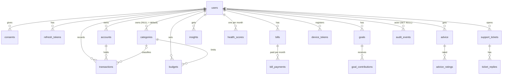

# FINORA — Database Schema

MySQL 8, managed by Flyway (`api/src/main/resources/db/migration/V1…V7`). Never edit an applied migration — add a new numbered migration.

**Conventions:** `id BIGINT AUTO_INCREMENT`; `created_at DATETIME(6)` UTC; money `DECIMAL(15,2)` LKR (D06) with `CHECK (> 0)`; months `CHAR(7)` `YYYY-MM` with a format CHECK; ownership via `user_id`.

## Delete rules
- Deleting a **user** removes every row they own (`ON DELETE CASCADE`) → supports data deletion (T36).
- Deleting a **category** sets `transactions.category_id` / `bills.category_id` to NULL — money records are never lost. Budgets for that category are removed.
- Deleting an **account** cascades to its transactions; the API must block this and archive instead (T09).
- **Audit events** and **tickets handled by deleted staff** survive; the link becomes NULL.
- MySQL reports CHECK failures as error **3819** (`UncategorizedSQLException`, not `DataIntegrityViolationException`) — the T04 error handler must map it to 400.

## ER diagram

## Tables

| Table | Migration | Purpose | Key constraints |
|---|---|---|---|
| `users` | V1 | Accounts for USER / ADMIN / STAFF | `email` unique; role, status, language enums |
| `consents` | V1 | Over-18 + consent version, withdrawal time | FK user cascade |
| `refresh_tokens` | V1 | SHA-256 hashes of refresh tokens (D07) | `token_hash` unique |
| `accounts` | V2 | Bank / cash / card / wallet | unique (user, name) |
| `categories` | V2 | Defaults (`user_id NULL`) + user-own; EN + SI names, need/want | unique (user, kind, name) |
| `transactions` | V2 | Income / expense records, source MANUAL/SMS/PASTE/CSV | amount > 0; unique (user, dedup_hash); index (user, txn_date) |
| `budgets` | V3 | Monthly limit per category | unique (user, category, month) |
| `bills` | V3 | Monthly bills, `due_day` 1–31 | amount > 0 |
| `bill_payments` | V3 | Paid marker per bill per month | unique (bill, month) |
| `goals` | V3 | Savings goals | target > 0 |
| `goal_contributions` | V3 | Money put toward a goal | amount > 0 |
| `insights` | V4 | Detected patterns with their facts (JSON) | index (user, month) |
| `health_scores` | V4 | Monthly score 0–100 + parts (JSON) | unique (user, month); 0 ≤ total ≤ 100 |
| `score_inputs` | V7 | D20 user declarations: nullable emergency reserve/date and no-applicable-debt/goals flags; UTC confirmation time | unique (user, month); user deletion cascades; nonnegative reserve/date pair in month |
| `advice` | V4 | RULE / AI advice, mode BETA / V1 (D03), `verified` flag | index (user, month) |
| `advice_ratings` | V4 | 1–5 rating | unique (advice, user); 1 ≤ rating ≤ 5 |
| `device_tokens` | V5 | FCM tokens | `token` unique |
| `sms_formats` | V5 | Versioned bank SMS templates (D04) — no real SMS | unique (bank_code, version) |
| `support_tickets` | V5 | User help requests, optional staff assignee | staff FK set null |
| `ticket_replies` | V5 | Replies on tickets | author FK set null |
| `audit_events` | V5 | Admin/security actions — never financial or personal data | actor FK set null |

V6 seeds 17 default categories (4 income, 13 expense) with Sinhala names (review in T39.4).
