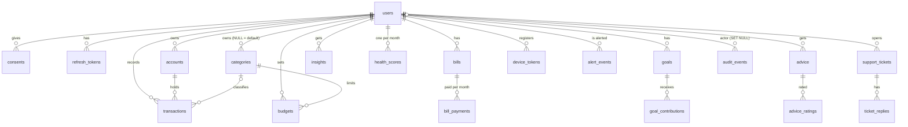

# FINORA — Database Schema

MySQL 8, managed by Flyway (`api/src/main/resources/db/migration/V1…V7`). Never edit an applied migration — add a new numbered migration.

**Conventions:** `id BIGINT AUTO_INCREMENT`; `created_at DATETIME(6)` UTC; money `DECIMAL(15,2)` LKR (D06) with `CHECK (> 0)`; months `CHAR(7)` `YYYY-MM` with a format CHECK; ownership via `user_id`.

### D64 password reset (V25)

`password_reset_codes` has one active BCrypt hash, UTC creation/expiry and an attempt count per user. `password_reset_issues` keeps issuance timestamps independently of the replaceable code so consumption cannot reset the rolling hourly limit. Both tables cascade on user deletion. [Migration](../api/src/main/resources/db/migration/V25__password_reset_codes.sql)

## Delete rules
- Deleting a **user** removes every row they own (`ON DELETE CASCADE`) → supports data deletion (T36).
- Deleting a **category** sets `transactions.category_id` / `bills.category_id` to NULL — money records are never lost. Budgets for that category are removed.
- Deleting an **account** cascades to its transactions; the API must block this and archive instead (T09).
- **Audit events** and **tickets handled by deleted staff** survive; the link becomes NULL.
- MySQL reports CHECK failures as error **3819** (`UncategorizedSQLException`, not `DataIntegrityViolationException`) — the T04 error handler must map it to 400.

## ER diagram

## Tables

| Table | Migration | Purpose | Key constraints |
|---|---|---|---|
| `users` | V1 | Accounts for USER / ADMIN / STAFF; V23 adds `alert_budget`, `alert_bill`, `alert_goal` (default TRUE) | `email` unique; role, status, language enums |
| `consents` | V1 | Over-18 + consent version, withdrawal time | FK user cascade |
| `refresh_tokens` | V1 | SHA-256 hashes of refresh tokens (D07) | `token_hash` unique |
| `accounts` | V2 | Bank / cash / card / wallet | unique (user, name) |
| `categories` | V2 | Defaults (`user_id NULL`) + user-own; EN + SI names, need/want | unique (user, kind, name) |
| `transactions` | V2 | Income / expense records, source MANUAL/SMS/PASTE/CSV | amount > 0; unique (user, dedup_hash); index (user, txn_date) |
| `budgets` | V3 | Monthly limit per category | unique (user, category, month) |
| `bills` | V3 | Monthly bills, `due_day` 1–31 | amount > 0 |
| `bill_payments` | V3 | Paid marker per bill per month | unique (bill, month) |
| `goals` | V3 | Savings goals | target > 0 |
| `goal_contributions` | V3 | Money put toward a goal | amount > 0 |
| `insights` | V4 | Detected patterns with their facts (JSON) | index (user, month) |
| `health_scores` | V4 | Monthly score 0–100 + parts (JSON) | unique (user, month); 0 ≤ total ≤ 100 |
| `score_inputs` | V7 | D20 user declarations: nullable emergency reserve/date and no-applicable-debt/goals flags; UTC confirmation time | unique (user, month); user deletion cascades; nonnegative reserve/date pair in month |
| `advice` | V4, V11, V24 | RULE / AI advice, mode BETA / V1 (D03), `verified` flag; V24 `focus_goal_id` (no FK) and stored `focus_key` = COALESCE(focus_goal_id, 0) (D58) | index (user, month); unique (user, month, focus_key, monthly_delivery) |
| `advice_ratings` | V4 | 1–5 rating | unique (advice, user); 1 ≤ rating ≤ 5 |
| `device_tokens` | V5 | FCM tokens (T34.1: max 10 per user) | `token` unique |
| `alert_events` | V23 | T34 alert events: type, ref_id, period, sent_at; no amounts or text | unique (user_id, type, ref_id, period); cascade on user delete |
| `sms_formats` | V5 | Versioned bank SMS templates (D04) — no real SMS | unique (bank_code, version) |
| `support_tickets` | V5 | User help requests, optional staff assignee | staff FK set null |
| `ticket_replies` | V5 | Replies on tickets | author FK set null |
| `audit_events` | V5 | Admin/security actions — never financial or personal data | actor FK set null |

V6 seeds 17 default categories (4 income, 13 expense) with Sinhala names (review in T39.4).

D41 adds `monthly_history` in V10 with owner/month uniqueness, exact decimal totals, nullable score, and a durable retry flag. The existing health-score total becomes nullable. Snapshot facts use decimal strings inside storage JSON to avoid binary rounding; API DTOs decode them into exact decimals. The scheduler targets the immediately preceding Colombo month and retries dirty rows after transaction commit. V11 adds a nullable V1 delivery marker and unique owner/month/marker key to the existing advice table. Legacy advice and rating rows retain their identifiers. Advice figures also use exact decimal strings inside storage JSON. The existing unique advice/user rating constraint remains authoritative. V12 adds one expiring generation claim per owner/month, with an opaque token and UTC expiry. Claim rows cascade on user deletion and store no financial or provider data.
D43 adds V13. `monthly_history.reconstructed_at` records the first reconstruction time in UTC and stays null on ordinary D27 snapshots. `history_recovery_policy` stores the first eligible Colombo month. `history_recovery_retry` stores the next attempt time per owner/month and cascades on user deletion. See the [production activation procedure](deploy.md#history-recovery-activation-d43).

T46.1 reads aggregate counts from V5 `support_tickets` without a schema change. Assigned and unassigned counts include OPEN and IN_PROGRESS only.

- V14 adds SMS diagnostic metadata and escalation states. A per-user UTC-day key deduplicates submissions. A generated unique key limits each bank/error group to one active escalation. No message bodies or financial values are stored.
- V15 adds immutable bilingual saved-reply revisions. The existing ticket and reply tables continue to store claims and rendered replies. Active revision uniqueness is enforced by a generated key.
- V16 adds STAFF activation hashes and expiry, plus credential generations on users and refresh tokens. Generation zero preserves existing sessions until an operator changes that STAFF account's state.
- V17 adds a singleton lock row for first-ADMIN bootstrap across concurrent backend instances.
- V18 distinguishes draft and published SMS deployment revisions. A generated unique key restricts active versions to one per bank, and a check rejects active drafts. The V9 NSB definition remains published and its payload remains hash-pinned.
## V22 default-category semantics (D55)

`categories.semantic_code` is nullable and unique. Only original default EXPENSE rows carry `SAVINGS` or `LOAN_PAYMENT`. The migration preserves category IDs, translated/display names, activity state and existing foreign keys. It requires canonical V6 ordered seed IDs corroborated by the seed cohort. For unsupported seed layouts, missing seed rows or ambiguous data, have the database owner verify the original rows from deployment or backup evidence and approve a forward remediation. Never infer the mapping from current labels.

T21 should match savings by `semantic_code = 'SAVINGS'`. If the analytics path reads the JPA category entity, map the column as read-only with `insertable = false, updatable = false`. Do not add a name fallback. T23 should match debt bills and loan transactions by `semantic_code = 'LOAN_PAYMENT'`. Keep the current joins and caller, period, bill and transaction filters. Do not use category activity for historical classification. Deploy the downstream code changes with the migration before accepting financial parity. Independently review any previously generated snapshots or advice affected by renames before deciding on repair.
